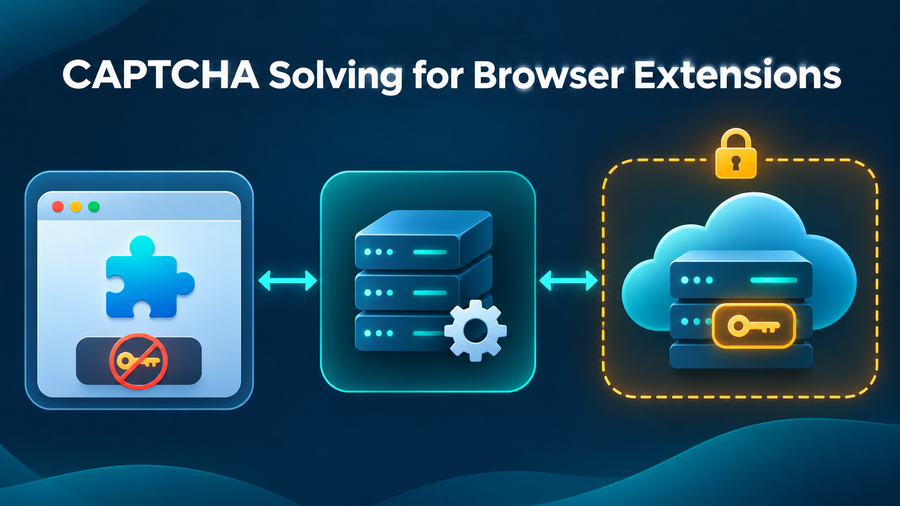

<div align="center">

# CAPTCHA Solving for Browser Extensions



A fixture-first Manifest V3 example that keeps the provider key outside the browser extension.

[English](README.md) · [简体中文](docs/zh-CN/README.md) · [日本語](docs/ja/README.md) · [Español](docs/es/README.md) · [Português](docs/pt-BR/README.md) · [한국어](docs/ko/README.md)

</div>

## Introduction

Browser extensions are easy to inspect, so embedding a CAPTCHA API key in extension code, storage, or network-visible configuration creates an avoidable secret-exposure risk. This repository demonstrates a safer split: the extension recognizes only an owned QA fixture, while a localhost companion validates the target and authorization reference before any provider adapter is considered. [CapSolver](https://www.capsolver.com/?utm_source=github&utm_medium=referral&utm_campaign=captcha-solving-browser-extension-example&utm_content=repository-readme) remains behind the server-side boundary.

## Features

- Manifest V3 extension restricted to the `qa.localhost` test origin.
- Local companion bound to `127.0.0.1` with strict request validation.
- Required authorization reference and target-origin allowlist.
- Official `createTask` payload builder for `ImageToTextTask`.
- Fixture-only default mode with no live API request.
- Five offline tests plus a deterministic smoke example.

## Architecture

```text
Owned QA page
    ↓ bounded fixture metadata
Manifest V3 extension
    ↓ POST to the localhost companion endpoint
Local companion service
    ↓ optional server-side adapter
CAPTCHA solving API
```

The extension never receives `CAPSOLVER_API_KEY`. The companion validates `authorizationRef`, checks the exact target origin, bounds image size, and emits an audit record that excludes image data.

## How It Works

The content script activates only when the allowlisted QA page contains a `data-captcha-fixture` element. The background service worker forwards the fixture to the localhost companion. The companion returns a deterministic response and stops; it does not contact a live target or provider.

`buildCreateTaskPayload()` mirrors the official [createTask request contract](https://docs.capsolver.com/en/guide/api-createtask/) with `clientKey`, `task.type`, and `task.body`. Production code should process provider responses according to the official [API error-code contract](https://docs.capsolver.com/en/guide/api-error/) and keep any result polling in the companion service.

## Quick Start

```bash
npm test
npm run smoke
node src/server.mjs
```

To inspect the extension, open the browser extension management page, enable developer mode, and load the `extension/` directory. The sample intentionally matches only the `qa.localhost` test origin; do not broaden host permissions without documenting ownership and authorization.

## Example Output

```json
{
  "providerPayload": {
    "clientKey": "[REDACTED]",
    "task": {"type": "ImageToTextTask", "body": "RklYVFVSRQ=="}
  },
  "audit": {
    "authorizationRef": "QA-FIXTURE-2026",
    "targetOrigin": "http://qa.localhost",
    "status": "fixture_ready",
    "retainedImage": false
  }
}
```

## Project Structure

```text
extension/   Manifest V3 example
src/         companion service and validated contract
tests/       offline contract tests
examples/    deterministic smoke example
docs/        localized guides
assets/      repository cover
```

## Testing

The test suite confirms the allowlisted path, rejects unapproved origins and missing authorization references, checks the documented task shape, and verifies that audit output does not retain image data.

## Security Notes

- Never place provider keys in `manifest.json`, extension storage, bundled JavaScript, or issue logs.
- Bind the companion to localhost unless a reviewed network design requires otherwise.
- Use exact host permissions rather than `<all_urls>`.
- Keep live mode disabled until target ownership, call budgets, timeouts, retention, and human stop conditions are documented.

## Responsible Use

Use this example only for pages you own or are explicitly authorized to test. Keep the target allowlist narrow, limit request volume, avoid personal or sensitive data, and stop when authorization changes. Do not use the extension for login automation, account creation, payment flows, private data, access-control evasion, or concealed automation.

## Conclusion

The companion-service pattern makes browser-extension CAPTCHA solving easier to review because secrets and provider calls stay outside the inspectable extension bundle. The fixture-first implementation offers a small starting point for authorized QA integrations with [CapSolver](https://www.capsolver.com/?utm_source=github&utm_medium=referral&utm_campaign=captcha-solving-browser-extension-example&utm_content=repository-readme).

## Maintainer Note

Developer sharing CapSolver integration examples.

## License

[MIT](LICENSE)
